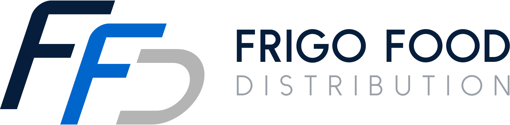

# Frigo Food Distribution brand pack

Open `index.html` for the brand guidelines (logo, colour, type, voice, do and don't, previews of every asset).

## Files

| Path | What it is |
|---|---|
| `logo/ffd-mark.svg` | FFD monogram, full colour, transparent |
| `logo/ffd-mark-white.svg` | Monogram for navy and dark backgrounds |
| `logo/ffd-logo-horizontal.svg` | Primary logo (mark + "FRIGO FOOD / DISTRIBUTION"), website header |
| `logo/ffd-logo-horizontal-white.svg` | Primary logo for dark backgrounds |
| `logo/ffd-logo-horizontal.png` | 760 × 201 transparent PNG, for email (Gmail/Outlook do not show SVG) |
| `logo/ffd-logo-stacked.svg` | Mark, wordmark, rule with snowflake, "REFRIGERATED TRANSPORT" |
| `logo/favicon.svg` | Simplified, heavier mark on a navy tile, for 16–32 px |
| `logo/apple-touch-icon.png` | 180 × 180 home-screen icon |
| `tokens.css` | CSS custom properties: colour, type, radius, shadow, spacing |
| `email-signature.html` | Copy-paste email signature, EN and RO |
| `business-card.html` | 85 × 55 mm card, 3 mm bleed, front and back, print to PDF |
| `letterhead.html` | A4 letterhead with legal footer, print to PDF |
| `social/og-image.svg` / `.png` | 1200 × 630 share preview (use the PNG for `og:image`) |
| `social/linkedin-banner.svg` / `.png` | 1584 × 396 LinkedIn cover |
| `truck-livery.svg` / `.png` | Reefer semi-trailer side view, 1200 × 420, transparent |
| `source/email-signature.png` | Original signature the mark was redrawn from |
| `source/generate-svgs.py` | Rebuilds every SVG above: `python3 brand/source/generate-svgs.py brand` from the repo root |

## Using it on the website

```html
<link rel="stylesheet" href="https://fonts.googleapis.com/css2?family=Archivo:wdth,wght@62..125,100..900&display=swap">
<link rel="stylesheet" href="/brand/tokens.css">
<link rel="icon" href="/brand/logo/favicon.svg" type="image/svg+xml">
<link rel="apple-touch-icon" href="/brand/logo/apple-touch-icon.png">
<meta property="og:image" content="https://frigofood.vercel.app/brand/social/og-image.png">

```

Display text: `font-family: var(--ff-font-display); font-stretch: var(--ff-display-stretch); font-weight: 750;`

## Notes

- The logo wordmarks are drawn as vector strokes, not live text, so the logo SVGs need no font and look identical everywhere.
- `og-image.svg`, `linkedin-banner.svg` and `truck-livery.svg` contain live Archivo text. Loaded through ``, browsers block the web font and fall back to Helvetica/Arial. To get Archivo, inline the SVG markup in the page (the page's font then applies) or use the PNG.
- Never retype the wordmark or recolour the mark. Silver (#B4B4B4) is for the mark only, never for text.
